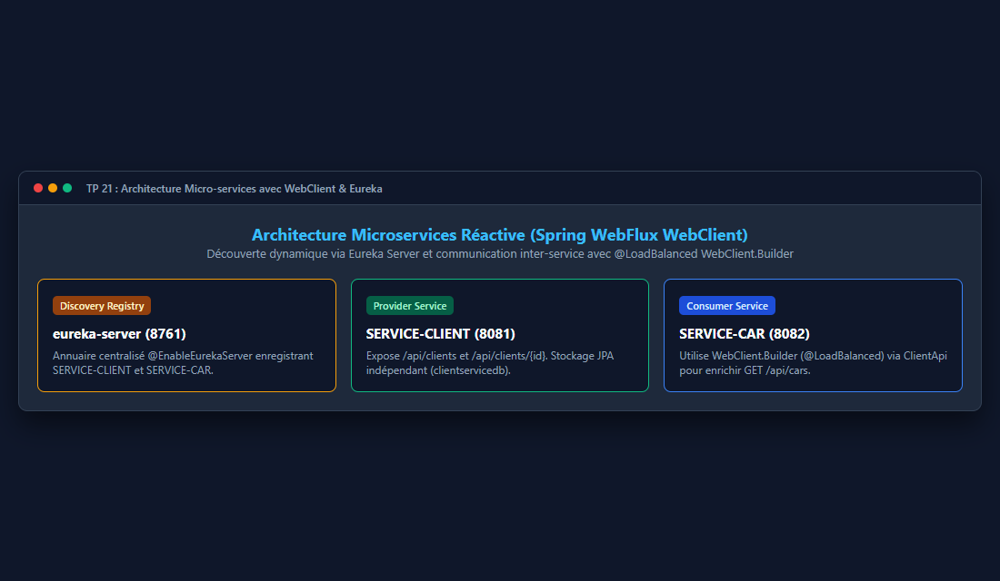
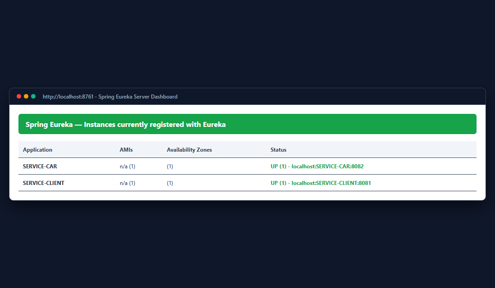
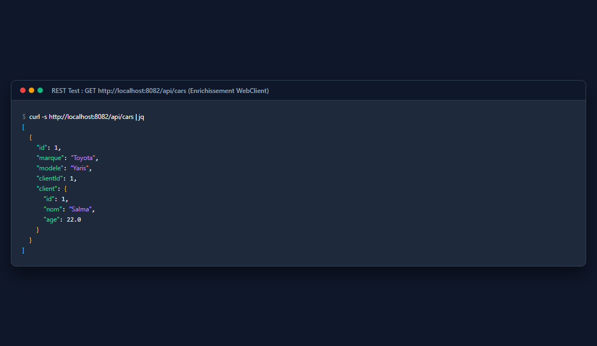

# TP 21 : Architecture Micro-services avec WebClient

> **Cours :** Architecture Microservices : Conception, Déploiement et Orchestration  
> **Auteur :** Moad Moussaoui

---

## 🎯 Objectifs du TP

1. Mettre en place un **Eureka Server** (`8761`) pour l'enregistrement et la découverte de microservices.
2. Développer deux microservices découplés : `SERVICE-CLIENT` (`8081`) et `SERVICE-CAR` (`8082`).
3. Configurer `WebClient.Builder` annoté avec `@LoadBalanced` pour appeler un microservice par son nom logique Eureka (`http://SERVICE-CLIENT/...`).
4. Implémenter le pattern d'enrichissement JSON (agrégation `Car` + `Client` via appel HTTP réactif).
5. Valider le fonctionnement complet par des tests automatisés Spring Boot (`MockMvc` + `H2`).

---

## 🏗️ Architecture



| Microservice | Port | Rôle |
| :--- | :--- | :--- |
| **`eureka-server`** | `8761` | Annuaire de découverte Netflix Eureka (`@EnableEurekaServer`) |
| **`service-client`** | `8081` | API REST `/api/clients` + Base JPA |
| **`service-car`** | `8082` | API REST `/api/cars` + `ClientApi` via `WebClient` |

---

## ⚙️ Points Techniques Clés

### Configuration `WebClient` avec `@LoadBalanced`
```java
@Configuration
public class WebClientConfig {
    @Bean
    @LoadBalanced
    public WebClient.Builder webClientBuilder() {
        return WebClient.builder();
    }
}
```

### Appel HTTP via `ClientApi`
```java
public Client findClientById(Long id) {
    return builder.build()
            .get()
            .uri("http://SERVICE-CLIENT/api/clients/" + id)
            .retrieve()
            .bodyToMono(Client.class)
            .block();
}
```

---

## 📸 Validation & Tests

### Tableau de bord Eureka (`http://localhost:8761`)


### Enrichissement JSON `GET /api/cars`


---

## 🚀 Exécution

```bash
# 1. Compiler et lancer les tests unitaires/d'intégration
mvn test

# 2. Démarrer les services dans l'ordre :
# Terminal 1 : eureka-server (8761)
cd eureka-server && mvn spring-boot:run

# Terminal 2 : service-client (8081)
cd service-client && mvn spring-boot:run

# Terminal 3 : service-car (8082)
cd service-car && mvn spring-boot:run
```
